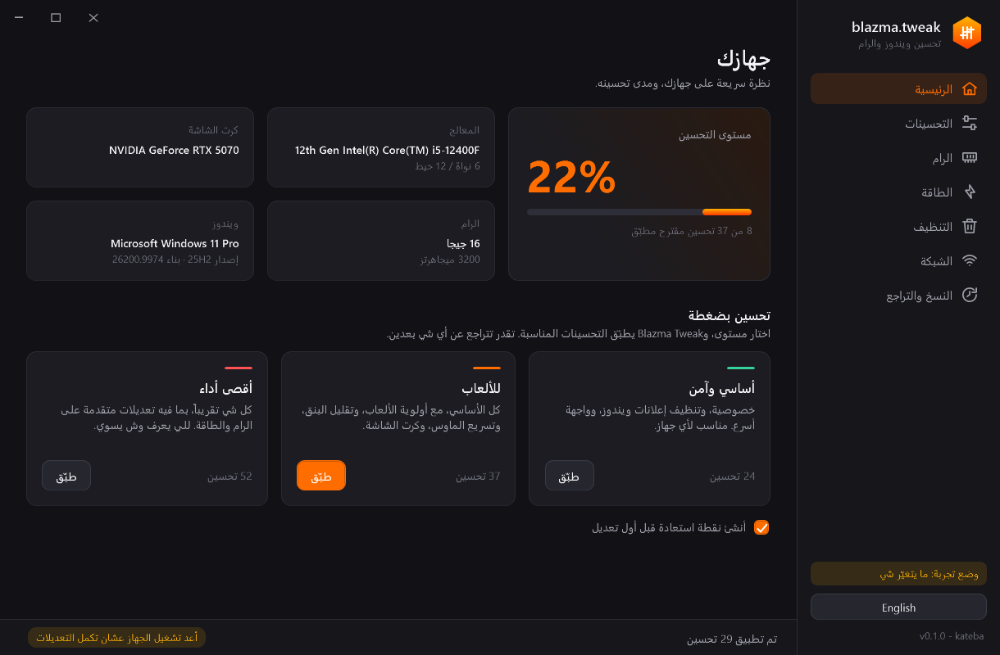
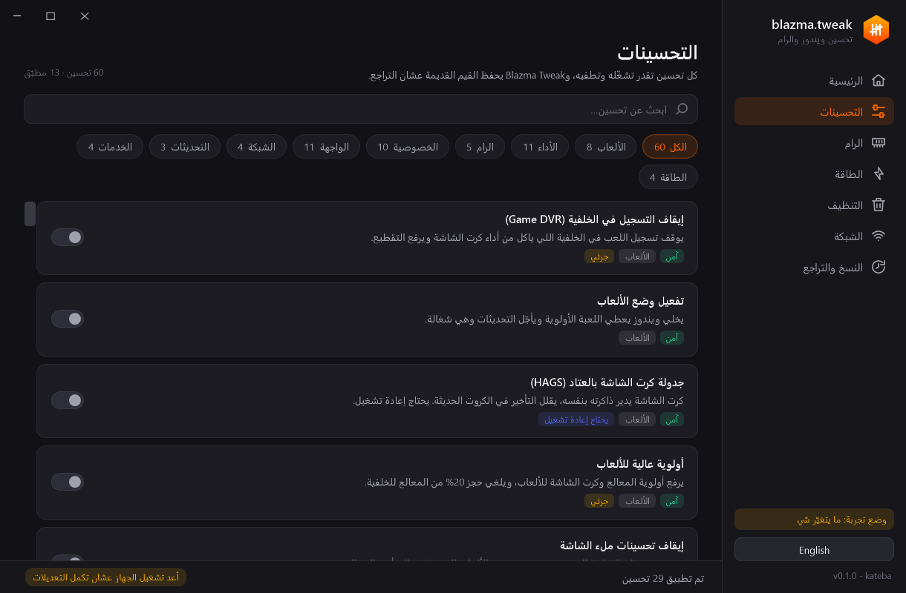
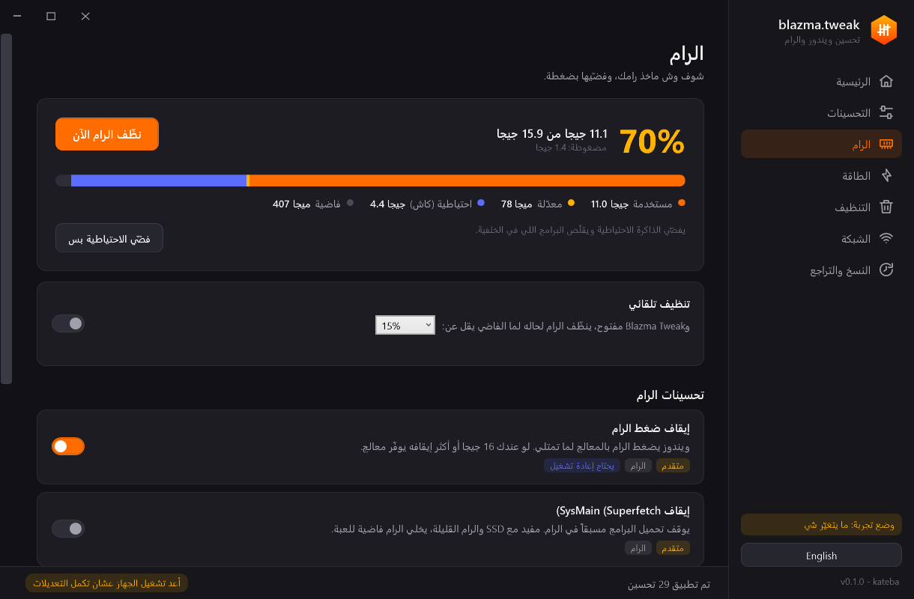
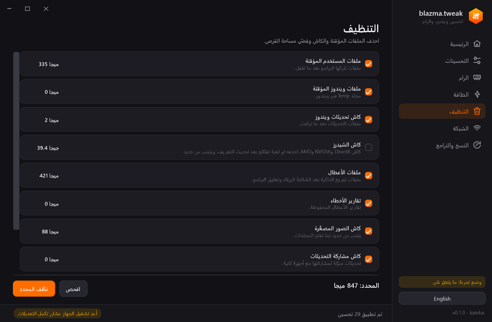
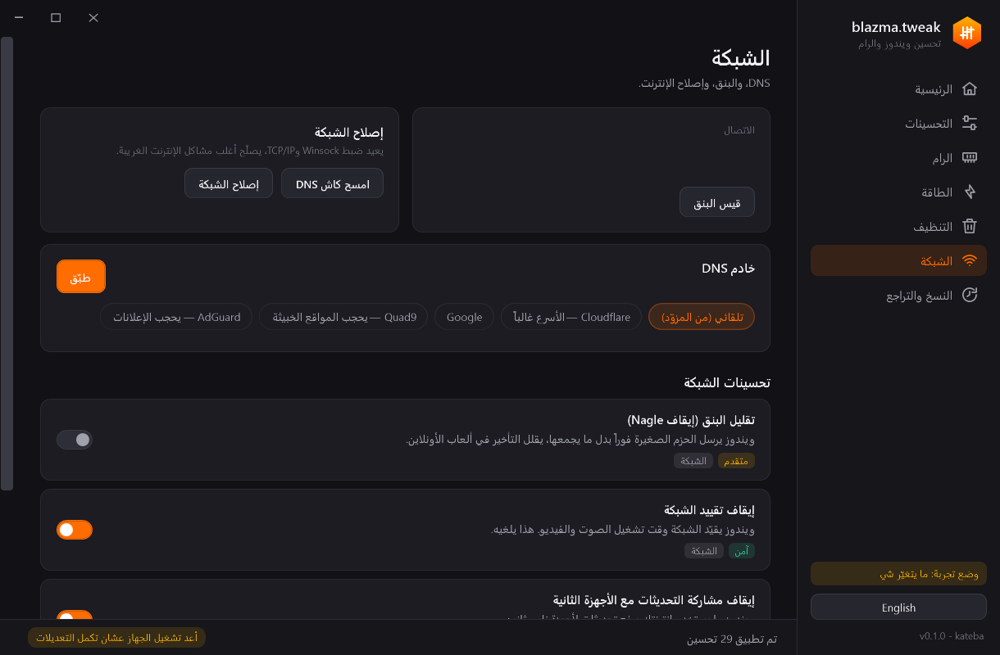
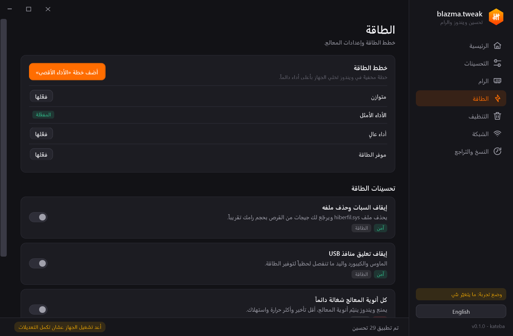
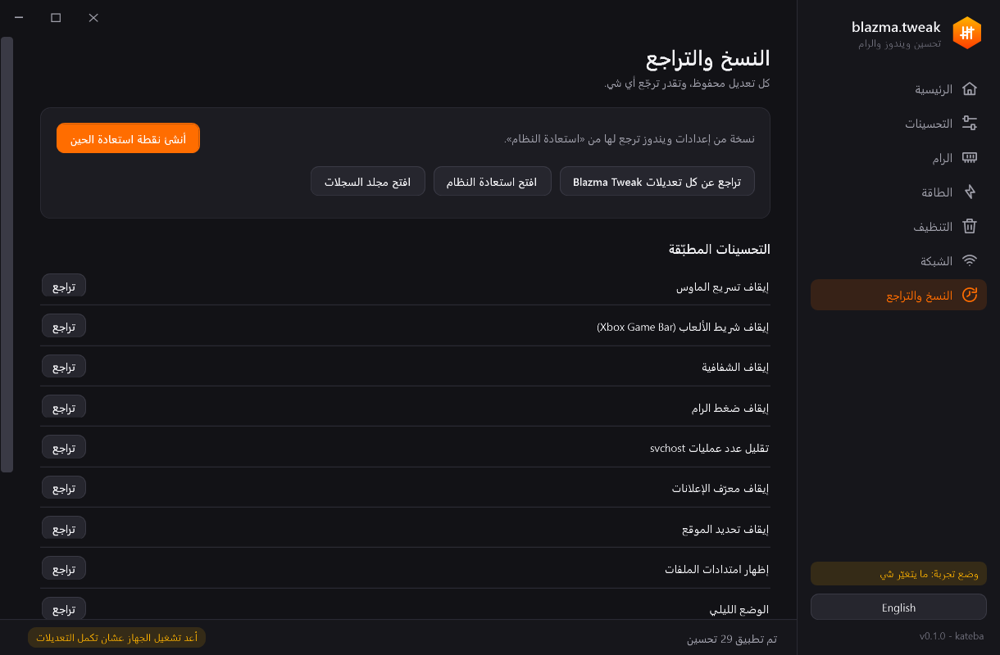

<div dir="rtl">

<p align="center">
  
</p>

<h1 align="center">Blazma Tweak</h1>

<p align="center">
  أداة عربية لتحسين ويندوز والرام والألعاب، تشتغل من PowerShell بأمر واحد.<br>
  كل تعديل ينحفظ قبل ما يتغيّر، وتقدر ترجّعه بضغطة.
</p>

<p align="center">
  <a href="https://github.com/mr-kateba/Blazma-Tweak/releases/latest"></a>
  <a href="LICENSE"></a>
</p>

---

## طريقة التشغيل

1. افتح **PowerShell كمسؤول**: كليك يمين على زر ابدأ واختر **Terminal (Admin)**
2. الصق الأمر واضغط Enter:

```powershell
irm mr-kateba.github.io/tweak | iex
```

لو فتحته بدون صلاحيات المسؤول، البرنامج يطلبها بنفسه.

## وش فيه؟

- **60 تحسين** في 9 أقسام: الألعاب، الأداء، الرام، الخصوصية، الواجهة، الشبكة، التحديثات، الخدمات، الطاقة. كل تحسين له زر تشغيل وإطفاء، ووصف عربي واضح، ودرجة خطورة (آمن، متقدم، خبير).
- **يعرف حالة جهازك:** أول ما يفتح يقرأ وش المطبّق أصلاً، ويعطيك «مستوى التحسين».
- **تحسين بضغطة:** ثلاث مستويات جاهزة: أساسي وآمن، للألعاب، أقصى أداء.
- **صفحة الرام:** تشوف الرام المستخدمة والمعدّلة والاحتياطية (الكاش) والفاضية بشكل حي، وتنظّفها بضغطة، أو تخليه ينظّفها لحاله لما تقل.
- **الطاقة:** خطط الطاقة، وإضافة خطة «الأداء الأقصى» المخفية في ويندوز، وإعدادات المعالج و USB.
- **التنظيف:** يفحص الملفات المؤقتة، وكاش التحديثات، وكاش الشيدرز، وملفات الأعطال، وسلة المحذوفات، ويوريك الحجم قبل الحذف.
- **الشبكة:** قياس البنق، وتغيير DNS (Cloudflare، Google، Quad9، AdGuard)، وإصلاح الشبكة.
- **النسخ والتراجع:** نقطة استعادة تلقائية قبل أول تعديل، وكل قيمة قديمة محفوظة، وزر يرجّع كل شي مثل ما كان.
- **عربي أو إنجليزي** من زر في القائمة.

## صور

<p align="center"></p>

<table>
  <tr>
    <td align="center"><br>التحسينات</td>
    <td align="center"><br>الرام</td>
  </tr>
  <tr>
    <td align="center"><br>التنظيف</td>
    <td align="center"><br>الشبكة</td>
  </tr>
  <tr>
    <td align="center"><br>الطاقة</td>
    <td align="center"><br>النسخ والتراجع</td>
  </tr>
</table>

## الأمان

- كل تعديل يحفظ القيمة القديمة في `%LOCALAPPDATA%\BlazmaTweak\backup.json` قبل ما يغيّرها، والتراجع يرجّعها بالضبط، ويحذف أي مفتاح سجل أنشأه البرنامج.
- السجل الكامل لكل اللي صار في `%LOCALAPPDATA%\BlazmaTweak\log.txt`.
- التحسينات «الخبير» تطلب تأكيد قبل التطبيق.
- البرنامج ما يرسل أي بيانات، وكل الكود مفتوح هنا.

## للمطوّرين

```powershell
./tests/run.ps1                                   # فحوصات (ما تغيّر شي في الجهاز)
./build.ps1                                       # يبني dist/BlazmaTweak.ps1
./dist/BlazmaTweak.ps1 -DryRun -NoElevate         # تشغيل تجريبي: يسجّل التعديلات بدل ما يطبّقها
./dist/BlazmaTweak.ps1 -DryRun -NoElevate -Shot docs/screenshots   # يصوّر كل الصفحات
```

- `src/core.ps1`: المحرك (السجل، الخدمات، المهام المجدولة، النسخ الاحتياطي، الرام، التنظيف، الطاقة، الشبكة).
- `src/main.ps1` و `src/ui.xaml`: الواجهة (WPF).
- `config/tweaks.json`: التحسينات. كل تحسين فيه قيم السجل أو الخدمات أو المهام، أو سكربت تطبيق وتراجع وفحص.
- `config/strings.json`: النصوص بالعربي والإنجليزي.

</div>

---

**English:** Blazma Tweak is a free, open-source Windows tuning tool with an Arabic (and English) interface: 60 reversible tweaks, a live RAM page with one-click and automatic cleaning, power plans, cleanup, DNS and network repair, restore points and full undo. Run `irm mr-kateba.github.io/tweak | iex` in an administrator PowerShell.
